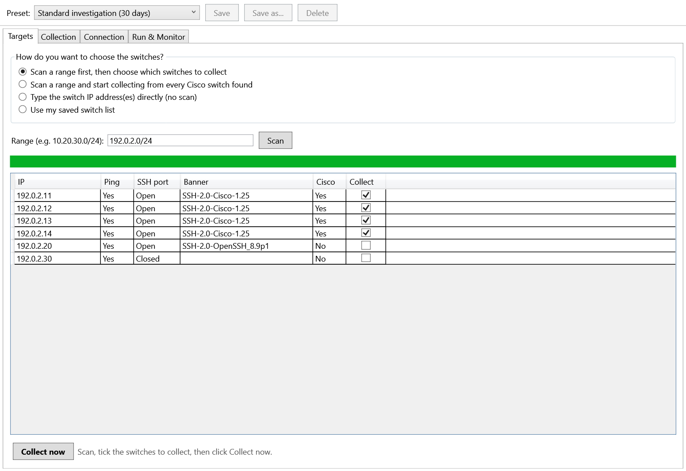
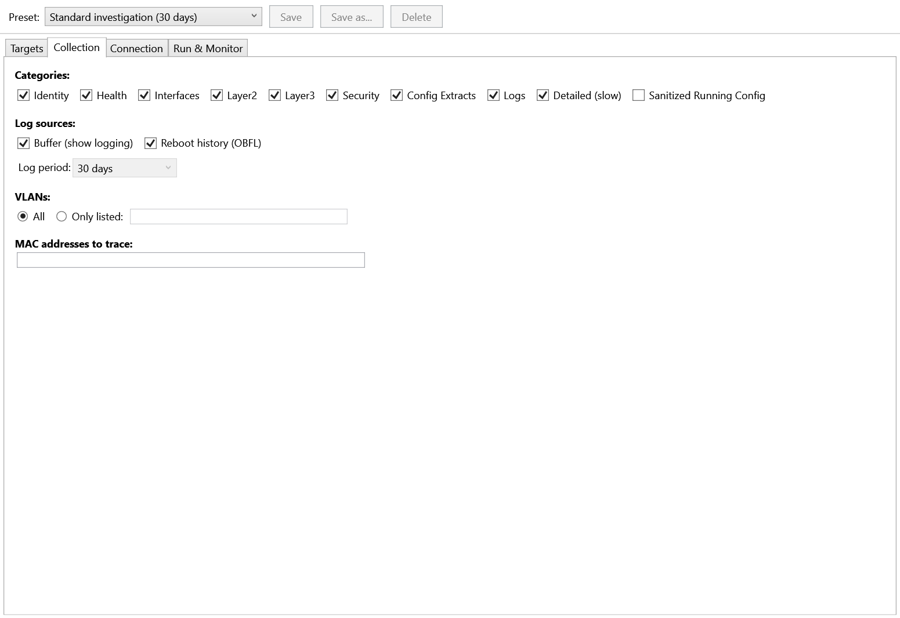
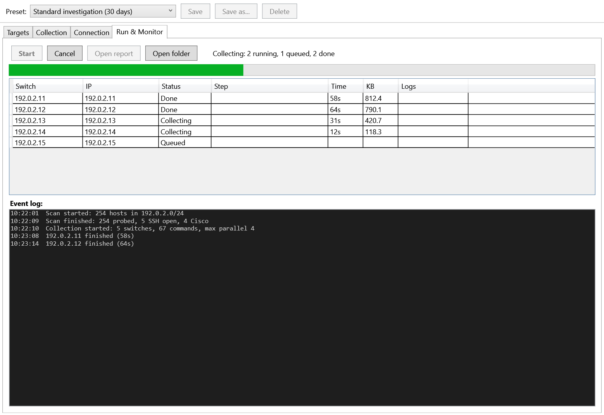

# Cisco C9200 OT Investigation Collector

A Windows tool for **read-only** diagnostic collection from Cisco Catalyst 9200 switches (IOS-XE) during authorized OT network investigations and audits. It finds the switches on a subnet, connects to them over SSH through PuTTY `plink.exe` (several at once), runs a broad set of `show` commands, and writes everything to one timestamped TXT report.

It is built for troubleshooting where the fault domain is unknown: missing VLANs, err-disabled ports, flapping links, STP changes, unexpected reboots, and what the logs say about them.



*Screenshots use sample data (documentation addresses `192.0.2.0/24`).*

> **Authorized use only.** Run it only against networks and devices you are allowed to scan and log in to. Scanning generates network traffic (see [Safety](#safety-and-operational-guidance)).

## What it can do

- **Windows GUI** (WPF) with live progress per switch and an event log.
- **Four ways to pick switches:**
  1. scan a range, then **choose** which switches to collect;
  2. scan a range and **start collecting immediately** from every Cisco switch found;
  3. **type the switch IP(s) directly**, no scan;
  4. use a saved switch list from `settings.json`.
- **Subnet scan** (for example a `/24`): ICMP echo, TCP port 22, and the SSH banner. A host is treated as a Cisco switch only when the banner is `SSH-x.x-Cisco...`. No login is attempted during a scan.
- **Parallel collection** (default 4 at a time, 1 to 10), never two sessions to the same IP, with a hard timeout per switch that keeps partial output.
- **Presets** for common investigations, plus category, VLAN, and MAC selection.
- **Read-only by construction:** every command is checked against an allowlist (`terminal`, `show`, `exit`; no `| redirect`, `| tee`, or `| append`).
- Password is asked once, kept as a `SecureString`, never saved, and never written to the report.

## Current status

This is what works today and what does not yet. Please read it before relying on the tool.

| Works | Not implemented yet |
|---|---|
| GUI, the four target modes, subnet scan, cancel during scan | **Log period filtering** (3/7/30/90 days). The report contains the full `show logging` buffer. The *Log period* selector is disabled. |
| Parallel collection with live progress and one consolidated TXT report | **Automatic host-key acceptance.** A switch whose SSH host key is not already trusted will fail. See [SSH host keys](#ssh-host-keys). |
| Presets (selecting them), categories, VLAN list, MAC trace | Preset **Save / Save as / Delete** buttons (disabled). Edit presets in `settings.json`. |
| `settings.json` overrides, pinned host keys | Choices made in the GUI are **not persisted** between runs. |
| Legacy sequential command-line mode (`-NoGui`, `-Mode`) | Parallel, scan, and preset options on the command line. |

Testing so far: 217 automated tests pass on both Windows PowerShell 5.1 and PowerShell 7, and the GUI was exercised end to end against a fake `plink` and local SSH-banner listeners. **It has not yet been run against a live Catalyst 9200.** Command syntax can vary by IOS-XE release (see [Troubleshooting](#troubleshooting)).

## Requirements

- Windows 10/11 or Windows Server with Desktop Experience.
- **Windows PowerShell 5.1** (built in). PowerShell 7 also works for the command line and tests.
- `plink.exe` from the official PuTTY distribution. PuTTY 0.77 or newer is recommended: it supports `-pwfile`, which keeps the password off the process command line. Older versions fall back to `-pw`.
- TCP/22 reachability to the switches, and an SSH account allowed to run `show` commands (a read-only account is best).

`plink.exe` is **not** included. Download it from the PuTTY website and put it next to the script, or add it to `PATH`, or browse to it in the Connection tab.

## Quick start

1. Clone or download this repository.
2. Put `plink.exe` in the project folder (or note where it is).
3. Make sure the switch's SSH host key is trusted (see [SSH host keys](#ssh-host-keys)).
4. Unblock the files if Windows marked them as downloaded:

   ```powershell
   Get-ChildItem -Recurse | Unblock-File
   ```

5. Double-click **`Start-Collector.cmd`**. It starts the GUI with `-ExecutionPolicy Bypass` for that process only. You can also run:

   ```powershell
   powershell.exe -NoProfile -ExecutionPolicy Bypass -STA -File .\CiscoC9200-OT-Investigation.ps1
   ```

6. **Connection tab:** enter the username and password (and the `plink.exe` path if it is not beside the script).
7. **Collection tab:** pick a preset or tick the categories you want.
8. **Targets tab:** choose how to select switches (below) and click **Collect now**.
9. Watch **Run & Monitor**. When it finishes, click **Open report**.

If the GUI cannot load, the script prints why and falls back to the command-line mode.

## Choosing the switches (Targets tab)

| Mode | What happens when you click the action button |
|---|---|
| **Scan a range first, then choose** (default) | **Scan** probes the range and lists what it found. Tick or untick the **Collect** column, then click **Collect now**. Cisco switches are ticked for you. |
| **Scan a range and start collecting** | **Collect now** scans the range and starts collecting from every Cisco switch found, without further clicks. Username, password, and `plink.exe` are checked *before* the scan starts. |
| **Type the switch IP address(es) directly** | Enter one or more IPv4 addresses (separated by comma, space, or new line) and click **Collect now**. No scan is done. |
| **Use my saved switch list** | Collects from the enabled entries of `targets.switches` in `settings.json`. |

In both scan modes the range is a CIDR such as `10.20.30.0/24`, or a comma-separated list of ranges and single IPs. The scan size is capped at 1024 hosts by default (`targets.maxScanHosts`) to avoid scanning a large network by accident. **Cancel** stops a scan in progress.

Hosts that answer ping but have no SSH port open, or that show a non-Cisco SSH banner, are listed but not ticked, and `plink` is never started against a host you did not select.

## Presets

Selecting a preset fills in the Collection tab. These are built in:

| Preset | Categories | Log sources |
|---|---|---|
| Quick triage (3 days) | Identity, Health, Interfaces, Layer2, Layer3, Security, ConfigExtracts, Logs | Buffer |
| Standard investigation (30 days) | Quick triage + Detailed | Buffer, Reboot history |
| Deep investigation (90 days) | Standard + SanitizedRunningConfig | Buffer, Reboot history |
| Logs only | Identity, Logs | Buffer, Reboot history |
| VLAN focus | Identity, Layer2, Logs, VLANs = only listed | Buffer |
| MAC trace | Identity, Layer2, Layer3 | none |

> The day counts in the preset names are stored with the preset, but the period is not applied to the report yet (see [Current status](#current-status)).



## Collection options

- **Categories** choose which groups of commands run (full list below).
- **Log sources:** *Buffer* runs `show logging`. *Reboot history* runs `show logging onboard switch active uptime detail`.
- **VLANs:** *All*, or *Only listed* (for example `10,20,30-35`; VLAN IDs 1 to 4094, at most 64). With the **Layer2** category ticked, each listed VLAN adds `show vlan id N`, `show spanning-tree vlan N detail`, and `show mac address-table vlan N`.
- **MAC addresses to trace:** any common format (`00:11:22:33:44:55`, `00-11-22-33-44-55`, `0011.2233.4455`). Each adds `show mac address-table address <mac>` (and an ARP lookup when Layer3 is selected).

Every run also sends `terminal length 0`, `terminal width 511`, `show clock detail`, and finishes with `exit`.

## Connection settings

| Setting | Default | Notes |
|---|---|---|
| Username | `network-admin` | Replace with your account. Prefer a read-only one. |
| Password | n/a | Asked in the GUI, never saved. |
| Plink path | beside the script, then `PATH`, then `C:\Program Files\PuTTY` | |
| Max parallel | 4 | 1 to 10 switches at the same time. |
| Per-switch timeout | 175 s | When reached, `plink` is stopped and the output received so far is kept. |
| Report directory | the script folder | A relative path is resolved against the script folder. |

## settings.json (optional)

The defaults live in `settings.default.json`. To change them, create a `settings.json` next to the script; its values are merged over the defaults (objects merge, arrays replace). It is git-ignored, so site-specific data stays out of the repository.

```json
{
  "connection": {
    "username": "svc-readonly",
    "plinkPath": "C:\\Tools\\plink.exe",
    "maxParallel": 6,
    "perSwitchTimeoutSeconds": 240
  },
  "targets": {
    "scanRanges": ["10.20.30.0/24"],
    "switches": [
      { "name": "SITE-A-OT-SW-01", "ip": "10.20.30.11", "enabled": true },
      { "name": "SITE-A-OT-SW-02", "ip": "10.20.30.12", "enabled": true }
    ]
  },
  "hostKeys": {
    "10.20.30.11": "ssh-ed25519 255 SHA256:REPLACE_WITH_VERIFIED_FINGERPRINT"
  },
  "report": { "directory": "reports" }
}
```

Notes:

- `presets` is an array, so defining it in `settings.json` **replaces the whole built-in list**. Copy the entries you want to keep from `settings.default.json`. A preset has `name`, `description`, `categories`, `logs` (`sources`, `days`), `vlans` (`mode`, `list`), and `macs`.
- Never put passwords in this file. None is read from it.

## SSH host keys

`plink` runs in `-batch` mode, so it cannot ask whether to trust a new host key. Today you need to do **one** of these before collecting from a switch:

- **Trust it once in PuTTY** for the Windows user that runs the tool: run `plink.exe -ssh user@<switch-ip>`, check the fingerprint through a trusted channel, answer `y`, then exit. The key is stored in the registry (`HKCU\Software\SimonTatham\PuTTY\SshHostKeys`).
- **Pin the verified fingerprint** in `settings.json` under `hostKeys` (example above). The tool then passes it to `plink` with `-hostkey` (this path has not yet been validated against a live switch, so confirm it on your first run).

If neither is done, that switch's block in the report shows the `plink` host-key message and no data. Never accept an unexpected *changed* key without investigating. The GUI's host-key policy box and `known_hosts.json` are reserved for the planned automatic acceptance on first use.

## Report

One file per run, named `Cisco_C9200_OT_Investigation_YYYYMMDD_HHMMSS.txt`, in the report directory. It contains:

- A header: start time, operator account, preset, switch count, `plink` path, whether `-pwfile` is used, commands per switch, and max parallel.
- One block per switch, written in the order they were selected: the host key used (when pinned), **RAW CLI OUTPUT** exactly as received, **PLINK STDERR** when there is any, and **COLLECTION RESULT** (exit code, timed out or not, finish time, duration).
- A **COLLECTION SUMMARY** table (switch, IP, status, duration, KB, notes) with start and end times. Its *Log coverage* column is reserved and currently empty.

A status of **Done** means `plink` exited. Always check the *Exit code* and *PLINK STDERR* in the block: a failed login, for example, also ends as Done with a non-zero exit code. **TimedOut** means the per-switch timeout was reached and partial output was kept.



The report can contain real hostnames, addresses, interface descriptions, MAC addresses, configuration extracts, ACLs, routes, and logs. Store it securely and never commit it to a public repository (files named `Cisco_C9200_OT_Investigation_*.txt` are git-ignored).

## Command line (legacy sequential mode)

`-NoGui` or `-Mode` runs the original headless collector: one switch at a time, configured by the block at the top of `CiscoC9200-OT-Investigation.ps1` (`$User`, `$Switches`, `$LostMacs`, `$FocusVlans`, `$HostKeys`). `switches.example.ps1` shows the expected shape. It prompts once for the SSH password.

```powershell
# Fast / Standard (default) / Deep
.\CiscoC9200-OT-Investigation.ps1 -Mode Standard

# Tune the timeouts (per-switch 60-900 s, connect 1-30 s)
.\CiscoC9200-OT-Investigation.ps1 -Mode Fast -PerSwitchTimeoutSeconds 150 -SshConnectTimeoutSeconds 5

# Same flow without the GUI, using the default mode (Standard)
.\CiscoC9200-OT-Investigation.ps1 -NoGui
```

| Mode | Adds |
|---|---|
| `Fast` | Identity, Health, Interfaces, Layer2, Layer3, Security, ConfigExtracts, Logs |
| `Standard` | `Fast` + Detailed |
| `Deep` | `Standard` + SanitizedRunningConfig |

`-SettingsPath` points the GUI at a different settings file.

## Commands sent

These are the commands behind each category (from `lib/Commands.ps1`). Review them against your site's OT cybersecurity rules before use.

**Identity**: `show clock detail`, `show version`, `show inventory`, `show switch detail`, `show boot`, `show redundancy`

**Health**: `show platform`, `show platform resources`, `show platform software status control-processor brief`, `show processes cpu sorted 5sec`, `show processes memory platform sorted`, `show environment all`, `show power inline`, `show license summary`

**Interfaces**: `show interfaces status`, `show interfaces description`, `show ip interface brief`, `show interfaces counters`, `show interfaces counters errors`, `show interfaces transceiver detail`, `show interfaces switchport`, `show interfaces status err-disabled`, `show errdisable detect`, `show errdisable recovery`

**Layer2**: `show vlan brief`, `show interfaces trunk`, `show etherchannel summary`, `show etherchannel port-channel`, `show spanning-tree summary`, `show spanning-tree root`, `show spanning-tree blockedports`, `show spanning-tree inconsistentports`, `show mac address-table count`, `show mac address-table dynamic`, `show cdp neighbors detail`, `show lldp neighbors detail`, `show vtp status`

**Layer3**: `show ip arp`, `show ip route`, `show ip default-gateway`, `show ip protocols`, `show ntp associations`, `show ntp status`

**Security**: `show port-security`, `show port-security address`, `show authentication sessions`, `show access-lists`, `show ip access-lists`, `show ip dhcp snooping`, `show ip arp inspection`, `show ip verify source`, `show storm-control`, `show monitor session all`

**ConfigExtracts**: `show running-config | section ^interface`, `... | section ^vlan`, `... | section ^spanning-tree`, `... | section ^monitor session`, and a filtered `show running-config | include ^hostname|^ip default-gateway|^ip route|^ntp|^clock timezone|^logging host|^snmp-server location`

**Logs**: `show logging`, `show logging onboard switch active uptime detail`

**Detailed** (slower): `show spanning-tree detail`, `show interfaces`, `show platform software fed switch active punt rates interfaces`, `show platform software fed switch active punt cpuq rates`, `show diagnostic result switch all detail`

**SanitizedRunningConfig**: `show running-config | exclude password|secret|community|key-string|authentication-key|privacy-key`

`show tech-support` is never sent. Command support varies by IOS-XE release: an unsupported command returns a CLI error that stays in the report as evidence and does not stop the rest of the collection.

## Safety and operational guidance

- Use it only on networks and devices where collection and scanning are authorized, ideally in an approved support window.
- **The scan is not silent.** For every address in the range it sends one ICMP echo and one TCP connection to port 22, and reads the SSH banner. It sends no credentials. Keep ranges small in fragile OT segments.
- The tool sends only `terminal`, `show`, and `exit`. Even so, a large collection uses management-plane CPU and SSH sessions, so start with one switch before running many in parallel.
- Passwords are held as `SecureString` and cleared after use. With `-pwfile` support the password goes to a temporary file in your user temp folder, restricted to your account (best effort) and deleted when the run ends or is cancelled. Without it, `plink` receives `-pw`, which is visible in the process list while it runs.
- Protect reports as sensitive operational data. Do not commit reports, `settings.json`, or `known_hosts.json` (all git-ignored).

## Troubleshooting

**`plink.exe was not found`**: put it beside the script, add it to `PATH`, or set the path in the Connection tab.

**A switch's block shows a host-key message (for example "Connection abandoned") and no data**: the host key is not trusted yet. Trust it once in PuTTY or pin it in `settings.json` ([SSH host keys](#ssh-host-keys)).

**Status Done, but the block shows `Access denied` or a non-zero exit code**: authentication failed. Check the username, password, AAA/TACACS/RADIUS availability, and the account's privilege or command authorization.

**The scan finds nothing**: check routing/VPN, firewalls, and that SSH is enabled on the switch management interface. Hosts that block ping can still be found, since detection uses TCP/22 and the banner. If the banner is not `Cisco`, use the *Type the IP directly* mode.

**Some commands return `% Invalid input`**: availability depends on release, feature set, and hardware. The error stays in the report.

**A switch reaches the timeout**: use a lighter preset (drop Detailed), keep the VLAN list and MAC list short, or raise the per-switch timeout.

**The window does not open**: run from a regular desktop session with Windows PowerShell 5.1 (`-STA`). On Server Core, WPF is not available; use the command-line mode.

## Tests

The suite uses [Pester](https://pester.dev) (developed with 6.2) and covers the command catalog, settings, subnet scanning, host-key parsing, the collection engine, and the GUI layout.

```powershell
Install-Module Pester -Scope CurrentUser -Force   # once
Invoke-Pester -Path .\tests
```

Run it in both `powershell.exe` (5.1) and `pwsh` (7); a few bugs only show up on 5.1.

## Project structure

```text
CiscoC9200-OT-Investigation.ps1   entry point: GUI by default, legacy CLI with -NoGui / -Mode
Start-Collector.cmd               double-click launcher for the GUI
settings.default.json             defaults and built-in presets
switches.example.ps1              example config block for the legacy CLI mode
gui/                              WPF window (MainWindow.xaml) and its wiring (Gui.ps1)
lib/
  Commands.ps1                    command catalog, VLAN/MAC parsing, read-only allowlist
  Settings.ps1                    settings load/merge/validate/save, presets
  Network.ps1                     CIDR expansion, async subnet scan, target selection
  HostKeys.ps1                    host-key parsing, known-hosts store, key resolution
  Plink.ps1                       plink discovery, argument building, process start
  Collector.ps1                   parallel collection engine (queue, timeouts, cancel)
  LogFilter.ps1                   syslog timestamp parsing and filtering (not wired in yet)
  Report.ps1                      TXT report builders
tests/                            Pester tests and fixtures
docs/                             screenshots and the design spec
```

## Suggested GitHub topics

`cisco`, `catalyst-9200`, `cisco-ios-xe`, `powershell`, `plink`, `ot-network`, `industrial-network`, `network-troubleshooting`, `network-forensics`, `switch-audit`

## License

No license is included. Add an appropriate `LICENSE` file before defining reuse or redistribution terms.
